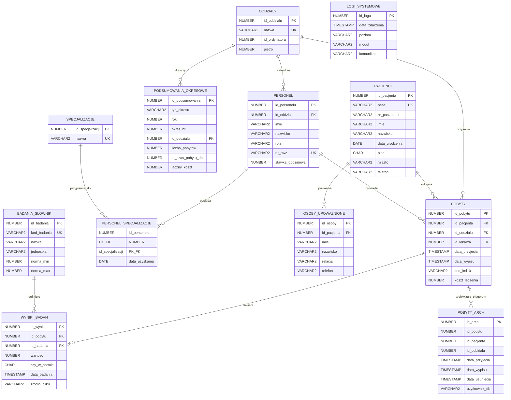

# Dokumentacja Projektu: Szpitalny System Informacyjny (HIS & EDM)

Dokumentacja techniczno-projektowa bazy danych Oracle dla Szpitalnego Systemu Informacyjnego (*Hospital Information System* – HIS) z modułem Elektronicznej Dokumentacji Medycznej (EDM), zrealizowanego w ramach przedmiotu **Zaawansowane Systemy Baz Danych**.

---

## 1. Metryka Projektu

| Parametr | Szczegóły |
| :--- | :--- |
| **Przedmiot** | Zaawansowane Systemy Baz Danych (ZSBD) |
| **Temat Projektu** | Szpitalny System Informacyjny (HIS) i Elektroniczna Dokumentacja Medyczna (EDM) |
| **Silnik Bazy Danych** | Oracle Database 23ai Free (Service Name: `FREEPDB1`, Port: 1521) |
| **Środowisko** | Konteneryzacja Docker & Docker Compose (`oracle-db` + `etl-service`) |
| **Data Realizacji** | Listopad 2026 |

---

## 2. Matryca Zgodności z Wymaganiami Projektu

Poniższa tabela stanowi bezpośrednie odzwierciedlenie wymagań określonych w sylabusie przedmiotu oraz wskazuje dokładne komponenty wdrożone w projekcie.

| Wymóg z Sylabusa / Projektu | Status | Zrealizowane Komponenty i Pliki Źródłowe |
| :--- | :---: | :--- |
| **Projekt schematu relacyjnego (min. 5–7 tabel, relacje, więzy)** | **100%** | **12 powiązanych tabel** relacyjnych (`ODDZIALY`, `PERSONEL`, `SPECJALIZACJE`, `PERSONEL_SPECJALIZACJE`, `PACJENCI`, `OSOBY_UPOWAZNIONE`, `POBYTY`, `BADANIA_SLOWNIK`, `WYNIKI_BADAN`, `POBYTY_ARCH`, `LOGI_SYSTEMOWE`, `PODSUMOWANIA_OKRESOWE`). Klucze główne `IDENTITY`, klucze obce z `ON DELETE CASCADE`, więzy `CHECK`, `UNIQUE`, 12 indeksów B-tree (`01_struktura_ddl.sql`). |
| **Skrypt ładujący dane (ETL, CSV/JSON, deamon/cron)** | **100%** | Hybrydowy moduł ETL w Pythonie (`etl/etl_loader.py`). Obsługa ładowania słowników z **CSV** oraz hospitalizacji i zagnieżdżonych badań z **JSON**. Tryb jednorazowy (`--once`) oraz ciągły demon (`--daemon` ze skanowaniem katalogu). Usługa Docker `etl-service` uruchamiana automatycznie po `healthy` bazy. |
| **Autonomiczny generator danych (brak zewnętrznych API)** | **100%** | Skrypt `etl/data_generator.py` generujący spójne dane testowe z celowo wstrzykiwanymi rekordami błędnymi (niepoprawny PESEL, PWZ, chronologia dat) w celu weryfikacji walidacji. |
| **Sprawdzanie poprawności danych (walidacja)** | **100%** | Dwuwarstwowa walidacja (Python + PL/SQL):<br>1. Algorytm sumy kontrolnej numeru **PESEL** z uwzględnieniem stuleci (`FNC_WALIDUJ_PESEL`, `validator.py`).<br>2. Algorytm weryfikacji 7-cyfrowego numeru **PWZ lekarza** według algorytmu NIL (`FNC_WALIDUJ_PWZ`, `validator.py`).<br>3. Chronologia dat przyjęć i wypisów (`chk_pobyty_daty`, `EX_NIEPOPRAWNE_DATY`).<br>4. Automatyczna weryfikacja norm laboratoryjnych (`TRG_WYNIKI_BADAN_BIU`). |
| **Gromadzenie i archiwizacja przetworzonych danych** | **100%** | 1. **Pliki ETL**: Przenoszenie z `inbox/` do `processed/` z unikalnym stemplem czasu `YYYYMMDD_HHMMSS`. Odrzucone rekordy zapisywane w formacie JSON w `failed/`.<br>2. **Baza danych**: Wyzwalacz `TRG_POBYTY_ARCH_DEL` archiwizuje usuwane hospitalizacje do tabeli `POBYTY_ARCH` (zapis usuniętego pobytu, daty i użytkownika Oracle).<br>3. **Audyt zdarzeń**: Tabela `LOGI_SYSTEMOWE` zasilana przez `PKG_LOGI` z `PRAGMA AUTONOMOUS_TRANSACTION`. |
| **Pakiety biznesowe PL/SQL (operacje DML, logika domenowa)** | **100%** | Dwa pakiety biznesowe (`03_pakiety_biznesowe.sql`):<br>1. `PKG_PACJENCI`: rejestracja pacjenta (`dodaj_pacjenta`), aktualizacja danych (`aktualizuj_dane`), usuwanie z kontrolą hospitalizacji (`usun_pacjenta`).<br>2. `PKG_HOSPITALIZACJE`: przyjęcie (`przyjmij_pacjenta`), wypis z automatyczną wyceną (`wypisz_pacjenta`), zlecanie badań (`zlec_badanie`). |
| **Własne wyjątki i obsługa błędów** | **100%** | Zdefiniowane i obsługiwane wyjątki domenowe:<br>- `EX_PACJENT_JUZ_ISTNIEJE` (`-20001`)<br>- `EX_NIEPOPRAWNY_IDENTYFIKATOR` (`-20002`)<br>- `EX_PACJENT_NIE_ISTNIEJE` (`-20003`)<br>- `EX_PACJENT_AKTYWNY` (`-20004`)<br>- `EX_PACJENT_JUZ_HOSPITALIZOWANY` (`-20010`)<br>- `EX_LEKARZ_NIE_NALEZY_DO_ODDZIALU` (`-20011`)<br>- `EX_NIEPOPRAWNE_DATY` (`-20013`)<br>- `EX_POBYT_JUZ_ZAMKNIETY` (`-20014`) |
| **Zaawansowane funkcje analityczne / okienkowe** | **100%** | Wdrożenie zaawansowanych funkcji okienkowych SQL:<br>1. `AVG(...) OVER (PARTITION BY ...)` – średni koszt na oddziale i odchylenie pobytu.<br>2. `DENSE_RANK() OVER (PARTITION BY ... ORDER BY ...)` – pozycja kosztowa w ramach oddziału.<br>3. `DENSE_RANK() OVER (ORDER BY ...)` – pozycja kosztowa w skali całego szpitala (`PKG_HOSPITALIZACJE.pobierz_ranking_kosztow`).<br>4. `LAG(...) OVER (PARTITION BY ... ORDER BY ...)` – dynamika kosztów miesiąc do miesiąca (`V_RAPORT_KOSZTY_MIESIECZNE`).<br>5. `SUM(...) OVER ()` – wyliczanie procentowego udziału rozpoznań ICD-10 w populacji (`V_RAPORT_DIAGNOZY_ICD10`). |
| **Podsumowania okresowe (kwartalne, roczne, miesięczne)** | **100%** | Tabela `PODSUMOWANIA_OKRESOWE` zasilana poleceniami `MERGE INTO` w pakietach:<br>- `PKG_HOSPITALIZACJE.generuj_podsumowanie_okresowe(rok, miesiac)`<br>- `PKG_RAPORTY.generuj_podsumowanie_kwartalne(rok, kwartal)`<br>- `PKG_RAPORTY.generuj_podsumowanie_roczne(rok)` (`04_raporty_i_widoki.sql`). |
| **Raporty i widoki przygotowane pod wykresy** | **100%** | Pakiet `PKG_RAPORTY` (`04_raporty_i_widoki.sql`) z funkcjami zwracającymi `SYS_REFCURSOR` oraz zestaw dedykowanych widoków SQL:<br>- `V_RAPORT_OBLOZENIE_ODDZIALOW`<br>- `V_RAPORT_KOSZTY_MIESIECZNE`<br>- `V_RAPORT_DIAGNOZY_ICD10`<br>- `V_RAPORT_LABORATORIUM_ANOMALIE`<br>- Widok zmaterializowany `MV_PODSUMOWANIE_ROCZNE`. |

---

## 3. Architektura Schematu Relacyjnego (ERD)

Schemat obejmuje 12 tabel powiązanych kluczami obcymi, gwarantujących pełną spójność danych medycznych, audyt oraz możliwość raportowania analitycznego.



---

## 4. Słownik Danych (Opis Tabel)

### 4.1. `ODDZIALY`
Przechowuje listę oddziałów szpitalnych (np. Kardiologia, Chirurgia, SOR).
- `id_oddzialu` (PK, IDENTITY) – unikalny identyfikator oddziału.
- `nazwa` (UNIQUE, NOT NULL) – pełna nazwa oddziału szpitalnego.
- `id_ordynatora` (NULLable) – referencja do lekarza pełniącego funkcję ordynatora.
- `pietro` (CHECK -1..20) – piętro budynku szpitala.

### 4.2. `PERSONEL`
Rejestr pracowników szpitala: lekarzy, pielęgniarek oraz personelu pomocniczego.
- `id_personelu` (PK, IDENTITY) – identyfikator pracownika.
- `id_oddzialu` (FK -> `ODDZIALY`) – przypisany oddział bazowy.
- `imie`, `nazwisko` (NOT NULL) – dane osobowe.
- `rola` (CHECK: 'LEKARZ', 'PIELEGNIARKA', 'ADMINISTRACJA', 'INNY') – rola zawodowa.
- `nr_pwz` (UNIQUE, NULLable) – 7-cyfrowy numer Prawa Wykonywania Zawodu lekarza.
- `stawka_godzinowa` (CHECK > 0) – stawka bazowa służąca do automatycznego wyliczania kosztu hospitalizacji.

### 4.3. `SPECJALIZACJE` i `PERSONEL_SPECJALIZACJE`
Obsługa relacji wiele-do-wielu (N:M) pomiędzy lekarzami a posiadanymi specjalizacjami medycznymi (np. kardiologia, chirurgia ogólna, anestezjologia).
- `data_uzyskania` – data formalnego uzyskania dyplomu specjalisty.

### 4.4. `PACJENCI`
Kartoteka pacjentów szpitala.
- `id_pacjenta` (PK, IDENTITY) – identyfikator kartoteki.
- `pesel` (UNIQUE, NULLable) – 11-cyfrowy numer PESEL dla obywateli RP.
- `nr_paszportu` (NULLable) – numer dokumentu tożsamości dla obcokrajowców.
- Warunek integralności biznesowej: pacjent musi posiadać `pesel` LUB `nr_paszportu`.
- `plec` (CHECK: 'K', 'M') – płeć pacjenta.

### 4.5. `OSOBY_UPOWAZNIONE`
Rejestr osób upoważnionych przez pacjenta do uzyskiwania informacji medycznej i odbioru dokumentacji (relacja 1:N z pacjentem).

### 4.6. `POBYTY`
Główna tabela zdarzeniowa rejestrująca hospitalizacje pacjentów.
- `id_pobytu` (PK, IDENTITY) – identyfikator hospitalizacji.
- `id_pacjenta` (FK -> `PACJENCI`) – pacjent podlegający hospitalizacji.
- `id_oddzialu` (FK -> `ODDZIALY`) – oddział leczniczy.
- `id_lekarza` (FK -> `PERSONEL`) – lekarz prowadzący.
- `data_przyjecia` (TIMESTAMP, NOT NULL) – moment przyjęcia pacjenta na oddział.
- `data_wypisu` (TIMESTAMP, NULLable) – moment wypisu (wartość `NULL` oznacza pobyt trwający).
- `kod_icd10` (VARCHAR2(10)) – kod diagnozy według Międzynarodowej Klasyfikacji Chorób ICD-10.
- `koszt_leczenia` (NUMBER(10,2)) – łączny koszt pobytu, kalkulowany automatycznie przy wypisie na podstawie czasu pobytu i stawki lekarza.

### 4.7. `BADANIA_SLOWNIK` i `WYNIKI_BADAN`
Zarządzanie badaniami laboratoryjnymi (EDM).
- `BADANIA_SLOWNIK`: kod badania (np. `GLU`, `CRP`, `TROP`), nazwa, jednostka miary, normy referencyjne (`norma_min`, `norma_max`).
- `WYNIKI_BADAN`: konkretne wyniki numeryczne pacjenta zrealizowane podczas danego pobytu. Wyzwalacz `TRG_WYNIKI_BADAN_BIU` automatycznie ewaluuje pole `czy_w_normie` ('T' / 'N').

### 4.8. `POBYTY_ARCH`
Tabela archiwum historii medycznej. Zgodnie z przepisami prawa medycznego, rekordy pobytów usunięte z bazy operacyjnej są automatycznie kopiowane do tabeli archiwalnej przez wyzwalacz `TRG_POBYTY_ARCH_DEL` wraz ze stemplem czasu i nazwą użytkownika bazy.

### 4.9. `LOGI_SYSTEMOWE`
Rejestr audytu zdarzeń systemowych, błędów i ostrzeżeń ETL zasilany procedurą `PKG_LOGI.zaloguj` działającą w trybie autonomicznej transakcji (`PRAGMA AUTONOMOUS_TRANSACTION`).

### 4.10. `PODSUMOWANIA_OKRESOWE`
Tabela zmaterializowanych zestawień agregujących metryki hospitalizacji per oddział w wymiarze miesięcznym, kwartalnym i rocznym (zasilana przez `MERGE INTO`).

---

## 5. Pakiety i Moduły PL/SQL

### 5.1. `PKG_PACJENCI`
Zarządzanie danymi pacjentów:
- `dodaj_pacjenta`: tworzy nową kartotekę pacjenta. Weryfikuje unikalność numeru PESEL/paszportu, przeprowadza walidację poprawności PESEL funkcją `FNC_WALIDUJ_PESEL`. Rzuca wyjątki `EX_PACJENT_JUZ_ISTNIEJE` lub `EX_NIEPOPRAWNY_IDENTYFIKATOR`.
- `aktualizuj_dane`: modyfikacja adresu i telefonu z weryfikacją istnienia pacjenta (`EX_PACJENT_NIE_ISTNIEJE`).
- `usun_pacjenta`: usuwanie pacjenta z blokadą w przypadku gdy pacjent posiada aktywną lub historyczną hospitalizację (`EX_PACJENT_AKTYWNY`).

### 5.2. `PKG_HOSPITALIZACJE`
Zarządzanie procesem leczenia szpitalnego:
- `przyjmij_pacjenta`: rejestracja nowego pobytu. Weryfikuje czy pacjent nie przebywa już na innym oddziale (`EX_PACJENT_JUZ_HOSPITALIZOWANY`) oraz czy lekarz prowadzący jest pracownikiem wskazanego oddziału (`EX_LEKARZ_NIE_NALEZY_DO_ODDZIALU`).
- `wypisz_pacjenta`: zamknięcie hospitalizacji. Sprawdza chronologię dat (`data_wypisu >= data_przyjecia`), rzuca `EX_NIEPOPRAWNE_DATY`. Automatycznie kalkuluje koszt pobytu (liczba rozpoczętych dni $\times$ stawka godzinowa lekarza $\times 8h$).
- `zlec_badanie`: rejestracja zlecenia badania laboratoryjnego z blokadą dla pobytów już zakończonych (`EX_POBYT_JUZ_ZAMKNIETY`).
- `pobierz_ranking_kosztow`: kursor analityczny wykorzystujący funkcje okienkowe:
  - `AVG(koszt_leczenia) OVER (PARTITION BY id_oddzialu)` – średni koszt na oddziale,
  - `DENSE_RANK() OVER (PARTITION BY id_oddzialu ORDER BY koszt_leczenia DESC)` – pozycja na oddziale,
  - `DENSE_RANK() OVER (ORDER BY koszt_leczenia DESC)` – pozycja w szpitalu.
- `generuj_podsumowanie_okresowe`: tworzy agregacje miesięczne w tabeli `PODSUMOWANIA_OKRESOWE`.

### 5.3. `PKG_RAPORTY`
Moduł zaawansowanej analityki, zestawień wielookresowych i raportowania:
- `generuj_podsumowanie_kwartalne(p_rok, p_kwartal)`: agregacja kwartalna hospitalizacji poleceniem `MERGE INTO PODSUMOWANIA_OKRESOWE` (`typ_okresu = 'KWARTALNY'`, `okres_nr = 1..4`).
- `generuj_podsumowanie_roczne(p_rok)`: agregacja roczna hospitalizacji (`typ_okresu = 'ROCZNY'`, `okres_nr = 1`).
- `pobierz_oblozenie_oddzialu(p_id_oddzialu, p_data_od, p_data_do)`: funkcja parametryczna zwracająca `SYS_REFCURSOR` z dziennym rozbiciem przyjęć, wypisów i sumy kosztów.
- `pobierz_efektywnosc_lekarzy(p_id_oddzialu)`: funkcja analityczna zwracająca `SYS_REFCURSOR` z metrykami pracy lekarzy: liczba pacjentów, średni czas pobytu, koszty, liczba zleconych badań laboratoryjnych oraz odsetek badań poza normą referencyjną.
- `pobierz_strukture_rozpoznan(p_rok)`: funkcja parametryczna analizująca częstość i koszty kodów ICD-10 z wyliczaniem procentowego udziału w badanej populacji.

---

## 6. Widoki Analityczne (Przygotowane pod Wykresy BI)

1. **`V_RAPORT_OBLOZENIE_ODDZIALOW`**
   - Zestawienie stanu bieżącego: oddział, piętro, liczba hospitalizacji aktywnych, zakończonych, średni czas pobytu w dniach, łączne przychody oddziału.
2. **`V_RAPORT_KOSZTY_MIESIECZNE`**
   - Miesięczna oś czasu kosztów leczenia z wykorzystaniem funkcji okienkowej `LAG()`: prezentuje koszt bieżącego miesiąca, koszt poprzedniego miesiąca oraz dynamikę kwotową m/m.
3. **`V_RAPORT_DIAGNOZY_ICD10`**
   - Ranking jednostek chorobowych ICD-10 z wyliczeniem procentowego udziału (`SUM() OVER ()`), średniego kosztu leczenia oraz pozycji w rankingu częstości (`DENSE_RANK()`).
4. **`V_RAPORT_LABORATORIUM_ANOMALIE`**
   - Analiza wyników laboratoryjnych: łączna liczba badań, odsetek wyników poza normą referencyjną (`procent_anomalii`), wartości minimalne, średnie i maksymalne.
5. **`MV_PODSUMOWANIE_ROCZNE`** (Widok Zmaterializowany)
   - Agregacja roczna według oddziałów: liczba hospitalizacji, średni czas pobytu, łączne koszty i liczba badań z odświeżaniem na żądanie (`REFRESH COMPLETE ON DEMAND`).

---

## 7. Moduł Zasilający i Walidujący (ETL w Pythonie)

Moduł ETL zlokalizowany w katalogu `PROJEKT/etl/` realizuje pełny obieg danych zasilających:

1. **Źródła danych**:
   - `01_oddzialy.csv`, `02_specjalizacje.csv`, `03_badania_slownik.csv`, `04_personel.csv`, `05_pacjenci.csv`, `06_osoby_upowaznione.csv` (format CSV).
   - `07_pobyty_i_badania.json` (format JSON z zagnieżdżonymi badaniami laboratoryjnymi).
2. **Niezależny Generator Danych (`data_generator.py`)**:
   - Generuje realistyczne dane medyczne bez używania zewnętrznych API sieciowych.
   - Celowo generuje partię testową zawierającą niepoprawny PESEL, niepoprawny PWZ oraz odwróconą chronologię dat wypisu.
3. **Silnik Walidacji (`validator.py`)**:
   - `WalidatorMedyczny.waliduj_pesel(pesel)` – algorytm sumy kontrolnej wag `[1, 3, 7, 9, 1, 3, 7, 9, 1, 3]`, dekodowanie stuleci i weryfikacja daty urodzenia.
   - `WalidatorMedyczny.waliduj_pwz(pwz)` – 7 cyfr, pierwsza cyfra jako suma kontrolna pozostałych 6 z wagami `[1, 2, 3, 4, 5, 6] mod 11`.
   - `WalidatorMedyczny.waliduj_daty_pobytu(przyjecie, wypis)` – weryfikacja chronologii.
4. **Ładowarka i Archiwizacja (`etl_loader.py`)**:
   - Zapewnia idempotencję (aktualizacje istniejących słowników, unikanie duplikatów).
   - Poprawnie przetworzone pliki przenosi do `data/processed/` z unikalnym prefiksem czasowym `YYYYMMDD_HHMMSS`.
   - Rekordy odrzucone wraz ze szczegółowym powodem błędu zapisuje w `data/failed/*_errors.json`.
   - Każde wykonanie i napotkany błąd loguje bezpośrednio do tabeli `LOGI_SYSTEMOWE` w bazie danych Oracle.

---

## 8. Instrukcja Uruchomienia i Testowania

### Krok 1: Uruchomienie kontenerów Docker
W katalogu `PROJEKT/`:
```bash
docker compose up -d
```
Docker automatycznie uruchomi bazę Oracle 23ai Free, wykona bootstrap skryptów DDL/PL/SQL z katalogu `init-scripts/`, poczeka na gotowość bazy (`healthy`), po czym usługa `etl-service` wygeneruje dane, dokona walidacji i zasili bazę.

### Krok 2: Połączenie z bazą w DBeaver
- **Host**: `localhost` (port: `1521`)
- **Database / Service Name**: `FREEPDB1`
- **User**: `his_admin`
- **Password**: `HisPassword123!`

### Krok 3: Przykładowe zapytania weryfikujące

```sql
-- 1. Podgląd stanu oddziałów i hospitalizacji
SELECT * FROM V_RAPORT_OBLOZENIE_ODDZIALOW;

-- 2. Dynamika kosztów leczenia miesiąc do miesiąca
SELECT * FROM V_RAPORT_KOSZTY_MIESIECZNE;

-- 3. Rozkład rozpoznań ICD-10
SELECT * FROM V_RAPORT_DIAGNOZY_ICD10;

-- 4. Statystyki anomalii w badaniach laboratoryjnych
SELECT * FROM V_RAPORT_LABORATORIUM_ANOMALIE;

-- 5. Wygenerowanie podsumowania kwartalnego i rocznego
BEGIN
    PKG_RAPORTY.generuj_podsumowanie_kwartalne(2026, 4);
    PKG_RAPORTY.generuj_podsumowanie_roczne(2026);
END;
/

-- 6. Odczyt wygenerowanych podsumowań okresowych
SELECT * FROM PODSUMOWANIA_OKRESOWE ORDER BY rok, typ_okresu, okres_nr;

-- 7. Wywołanie raportu efektywności lekarzy przez kursor
VAR rc REFCURSOR;
EXEC :rc := PKG_RAPORTY.pobierz_efektywnosc_lekarzy(NULL);
PRINT rc;

-- 8. Podgląd logów audytowych z ładowania ETL i bazy
SELECT poziom, modul, komunikat, data_zdarzenia 
FROM LOGI_SYSTEMOWE 
ORDER BY data_zdarzenia DESC;
```
